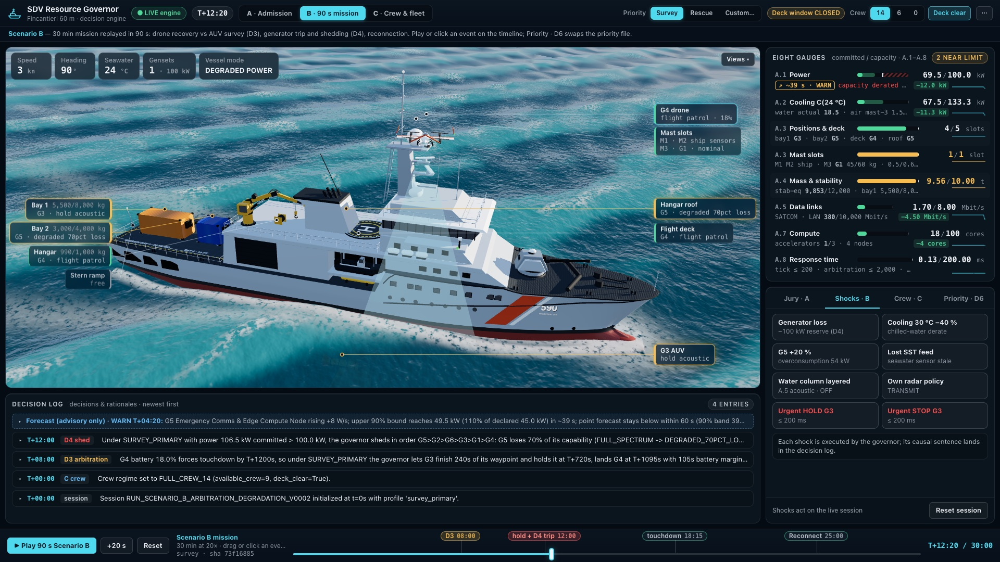
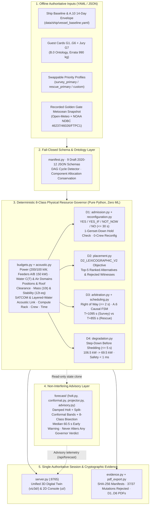

<!-- pdf-ignore-start -->
<h1 align="center">🥈 SDV Resource Governor</h1>

<p align="center">
  <strong>🥈 2nd Place Winner (Solo Builder · 1-Person Team) — <a href="https://luma.com/mvcg9eyw">Fincantieri Maritime Dual-Use Hackathon · San Francisco 2026</a></strong><br/>
  <sub>Track 3: Software-Defined Vessel · Powered by Fincantieri, Mind the Bridge, Silicon Mountain &amp; Qualcomm</sub><br/><br/>
  A deterministic, explainable resource governor that decides what a 60-70 m vessel can host, where, and who yields when the ship runs short. Every verdict names its binding constraint.
</p>

<p align="center">
  
  <br/><sub>The operator screen at T+12:20 of Scenario B: the genset trip has just forced the D4 step-down of G5, and every line in the log comes from the engine.</sub>
</p>

<p align="center">
  <a href="https://luma.com/mvcg9eyw"></a>
  <a href="tests/"></a>
  <a href="src/sdv_governor/evidence.py"></a>
  <a href="#6-explicit-limitations--honest-operational-boundaries"></a>
  <a href="https://www.python.org/"></a>
  <a href="docs/DEPLOYMENT_AND_BOM.md"></a>
  <a href="PROVENANCE.md"></a>
  <a href="LICENSE"></a>
</p>

<p align="center">
  <a href="#scope-coverage-at-a-glance"><strong>Scope coverage</strong></a> ·
  <a href="#1-architecture-diagram--data-flow">Architecture</a> ·
  <a href="#2-deliverables-objectives--scope-d1-d6">D1–D6</a> ·
  <a href="#3-quickstart-offline--5-minutes">Quickstart</a> ·
  <a href="#4-eight-class-resource-model">Eight budgets</a> ·
  <a href="#5-adding-a-7th-guest-card-without-touching-code">7th guest card</a> ·
  <a href="#6-explicit-limitations--honest-operational-boundaries">Limitations</a> ·
  <a href="#9-repository-structure">Repository</a>
</p>

> [!TIP]
> **Try it in one command:** `./run_demo.sh` → open `http://127.0.0.1:8765/`. One operator screen shows the ship, the eight Annex A gauges, the decision log and the jury test. Press **Play** for the 90 s Scenario B mission, or hand the engine any guest card under **Jury · A**. No network, no mocks: the screen calls the real engine.

## Scope coverage at a glance

| Brief requirement | Status | Where to verify |
|---|---|---|
| **D1 ·** Admission in ≤ 30 s: `YES` / `YES_IF` / `NOT_NOW` / `NO` with binding constraint, one-genset-down check | ✅ Delivered | [`admission.py`](src/sdv_governor/admission.py) · Jury · A tab · [§2](#2-deliverables-objectives--scope-d1-d6) |
| **D2 ·** Placement with declared objective and ranked alternatives | ✅ Delivered | [`placement.py`](src/sdv_governor/placement.py) · `placement_alternatives` / `rejected_placements` |
| **D3 ·** Right of way in ≤ 2 s under two priority profiles | ✅ Delivered | [`arbitration.py`](src/sdv_governor/arbitration.py) · [`data/priorities/`](data/priorities/) · Priority · D6 tab |
| **D4 ·** Graceful degradation: step down before shedding | ✅ Delivered | [`degradation.py`](src/sdv_governor/degradation.py) · genset trip at T+12:00 in Scenario B |
| **D5 ·** Crew as a setting (14 / 6 / 0), Scenario C memo ≤ 2 pages | ✅ Delivered | [`MEMO_SCENARIO_C.pdf`](docs/MEMO_SCENARIO_C.pdf) · Crew · C tab |
| **D6 ·** Physical Account: every assumed number traced to code | ✅ Delivered | [`PHYSICAL_ACCOUNT.pdf`](docs/PHYSICAL_ACCOUNT.pdf) · [`ASSUMPTIONS.yaml`](ASSUMPTIONS.yaml) |
| Guest manifest schema, five brief cards plus one of our own | ✅ Delivered | [`guest_manifest.schema.json`](schemas/guest_manifest.schema.json) · [`data/guests/`](data/guests/) (G1–G5 + G6) |
| A new guest card admitted without code changes | ✅ Delivered | [`docs/examples/G7_xbt_launcher.yaml`](docs/examples/G7_xbt_launcher.yaml) · [§5](#5-adding-a-7th-guest-card-without-touching-code) |
| Runnable with one command; decision engine not mocked | ✅ Delivered | [`run_demo.sh`](run_demo.sh) · [§3](#3-quickstart-offline--5-minutes) |
| README ≤ 3 pages: architecture, objectives, limitations, one more week | ✅ Delivered | [`README.pdf`](README.pdf) · [§1](#1-architecture-diagram--data-flow), [§6](#6-explicit-limitations--honest-operational-boundaries), [§7](#7-what-we-would-do-with-one-more-week) |
| Live demo: 90 s of Scenario B, then Scenario A with the jury's card | ✅ Delivered | [`DEMO_SCRIPT_90S.pdf`](docs/DEMO_SCRIPT_90S.pdf) |
| Same engine on the target edge board, bit-for-bit | ✅ Verified | [`DEPLOYMENT_AND_BOM.pdf`](docs/DEPLOYMENT_AND_BOM.pdf) · `sdv-governor deploy-board` |
| Public metocean data and an advisory forecast that never overrides a verdict | ➕ Beyond scope | [`FORECAST_AND_PUBLIC_DATA.pdf`](docs/FORECAST_AND_PUBLIC_DATA.pdf) · [§8](#8-public-data--forecasting-advisory) |

<details>
<summary><strong>All documents and supporting material</strong></summary>

| Document | Format | Limit |
|---|---|---|
| Physical Account (D6) | [PDF](docs/PHYSICAL_ACCOUNT.pdf) · [Markdown](docs/PHYSICAL_ACCOUNT.md) | 1 page |
| Scenario C memo (D5) | [PDF](docs/MEMO_SCENARIO_C.pdf) · [Markdown](docs/MEMO_SCENARIO_C.md) | ≤ 2 pages |
| This README | [PDF](README.pdf) | ≤ 3 pages |
| 90-second demo script | [PDF](docs/DEMO_SCRIPT_90S.pdf) · [Markdown](docs/DEMO_SCRIPT_90S.md) | 1 page |
| Golden Gate data and forecast | [PDF](docs/FORECAST_AND_PUBLIC_DATA.pdf) · [Markdown](docs/FORECAST_AND_PUBLIC_DATA.md) | ≤ 2 pages |
| Hardware deployment and BOM | [PDF](docs/DEPLOYMENT_AND_BOM.pdf) · [Markdown](docs/DEPLOYMENT_AND_BOM.md) | ≤ 2 pages |
| Slides (optional, for the finals) | [PDF](docs/PITCH_SLIDES.pdf) · [Markdown](docs/PITCH_SLIDES.md) | ≤ 10 slides |
| Provenance, AI use and third-party components | [PROVENANCE.md](PROVENANCE.md) · [AI_USE_DISCLOSURE.md](AI_USE_DISCLOSURE.md) · [THIRD_PARTY_COMPONENTS.csv](THIRD_PARTY_COMPONENTS.csv) | — |
| Security notes | [SECURITY.md](SECURITY.md) | — |

</details>

---
<!-- pdf-ignore-end -->

# SDV Resource Governor (`sdv-resource-governor`)

**Run the demo (one command):** `./run_demo.sh` opens the single operator screen at `http://127.0.0.1:8765/` (ship schematic, eight gauges, decision log, jury test; legacy console at `/console/`) (creates `.venv` and installs on first run). The same governor runs on the Arduino Ventuno Q (`http://10.0.0.130:8765`, trusted LAN only: the console is unauthenticated).

A deterministic resource governor for the 60-70 m reference vessel: it owns the eight Annex A budgets and decides **admission (D1), placement (D2), right of way (D3) and degradation (D4)**, treats **crew (D5: 14 / 6 / 0)** as a setting, and keeps every assumed number in the **Physical Account (D6)**. Every verdict names its binding constraint in one sentence built from the witness that bound it.

## 1. Architecture Diagram & Data Flow

<!-- pdf-ignore-start -->

<!-- pdf-ignore-end -->

```text
+--------------------------+   +-------------------------+   +-------------------------+
| Inputs (YAML, offline)   |-->| manifest.py: 7 JSON     |-->| budgets.py: 8 classes   |
| vessel_baseline, A.10    |   | Schemas, B.0 ontology   |   | power->heat 1:1, C(T),  |
| guests G1..G6 (+G7 card) |   | (part-of / requires /   |   | mast, mass x multiplier,|
| priority files (swap.)   |   | excludes), errata       |   | links, compute, time,   |
| scenario event timeline  |   +-------------------------+   | degraded state          |
+--------------------------+                                 +------------+------------+
                                                                          v
+---------------------------------------------------------------------------------------+
| Deterministic decision engine (no ML, no randomness, replayable)                      |
|  D1 admission.py   D2 placement.py   D3 arbitration.py   D4 degradation.py            |
|  D5 scheduling.py (crew 14/6/0)   D6 ASSUMPTIONS.yaml + evidence.py verifier          |
|  -> verdict + binding class + one-sentence rationale from the binding witness         |
+-------------------------------------------+-------------------------------------------+
                                            v
+---------------------------------------------------------------------------------------+
| server.py: one authoritative session -> single screen (viz3d/), console (ui/)         |
| forecast/: advisory only, never changes a verdict                                     |
+---------------------------------------------------------------------------------------+
```

## 2. Deliverables, Objectives & Scope (D1-D6)

| ID | Decision | What it optimises (declared objective) | Component and result |
|---|---|---|---|
| **D1** | Admission in 30 s (mandatory) | Feasibility over the whole 14-day A.10 envelope, degraded states included, never the pier; `YES_IF` options (throttle an installed guest or remove it) ranked by least capability lost, then fewest guests; states whether the verdict holds with one genset down (`YES` / `YES_WITH_STEP_DOWN` / `NO`). | `admission.py`: `YES` / `YES_IF` / `NOT_NOW` / `NO` with binding class and a one-sentence `headline`. A′ (A.11): bay/mast guests at sea get `NO` until port; G3/G4 vehicles get the swap window or `NOT_NOW` + next window. At sea with 0 crew it adds up to 3 logical reconfigurations (`reconfiguration.py`). |
| **D2** | Placement (addressed) | Objective `D2_LEXICOGRAPHIC_V2`, key `(roof_cond_rank, pref_penalty, -retention_milli, scarcity_cost, -min_margin_bucket, stab_eq, node_used_cores, nid)`: avoid conditional roof positions, then preferred positions, capability retained, least scarce slot (free mast = 3), largest minimum margin, least stability-equivalent mass, least-loaded node. | `placement.py`: bay, mast, deck, power line, cooling manifold; up to 5 ranked `placement_alternatives` with `why_not_chosen` and 5 `rejected_placements` with their binding witness. |
| **D3** | Right of way in 2 s (mandatory) | Max `utility_score` = priority-weighted survey continuity + priority-weighted landing margin, subject to the hard G4 < 20 % battery deadline; tie-break declared in the priority file. | `arbitration.py`: `survey_primary` lands G4 at T+1095 s (105 s margin, G3 loses 14 min); `rescue_primary` at T+855 s (345 s margin, G3 loses 26 min). |
| **D4** | Degradation (addressed) | Restore power/cooling feasibility with least capability lost: step down before shedding, in the priority file's order; never shed safety-critical, uninterruptible, airborne or submerged guests. | `degradation.py`: genset trip at T=720 s, committed 106.5 > 100 kW, G5 45 -> 8 kW; rationale states what every guest keeps or loses. |
| **D5** | Crew as a setting (memo) | One rule, "nobody on the flight deck during recovery", with crew-dependent confirmation (30 / 120 s / none) and deck clearing (240 / 600 s / impossible). | `scheduling.py`, `arbitration.py`; `docs/MEMO_SCENARIO_C.pdf`. |
| **D6** | Physical Account | Every assumed number traceable to the code that uses it. | `docs/PHYSICAL_ACCOUNT.pdf`, `ASSUMPTIONS.yaml`, evidence verifier (37 mutations, 0 false accepts). |

## 3. Quickstart (offline, < 5 minutes)

```bash
python3 -m venv .venv --system-site-packages
.venv/bin/pip install -r requirements-macos-arm64.lock
.venv/bin/pip install --no-build-isolation --no-deps -e . && .venv/bin/pytest -q
.venv/bin/sdv-governor campaign --run-id demo_run
.venv/bin/sdv-governor verify-evidence artifacts/demo_run --run-mutations
.venv/bin/sdv-governor serve --host 127.0.0.1 --port 8765
```

## 4. Eight-Class Resource Model

| Class | Model (Scenario B values) | Module |
|---|---|---|
| Power | 200 kW reserve (100 kW after a trip); two 150 kW lines; committed vs actual (106.5 -> 69.5 kW) | `budgets.py` |
| Cooling | C(T) 160 -> 120 kW from 12 to 30 C (133.3 kW at 24 C); -40 % loop fault; inertia 30 kW x 60 s | `budgets.py` |
| Positions | bays, flight deck / ramp exclusion, `mast_3` (60 kg, 2,000 W air), hangar roof under a recovery condition | `budgets.py`, `placement.py` |
| Mass | 10,000 kg and 12,000 kg-eq; G1+G3+G4+G5 = 9,560 kg / 9,853 kg-eq | `budgets.py` |
| Data links | SATCOM 2-8 Mbit/s (A.5; 6 in A.10 cruise, 0 in silence); acoustic link down with layered water, manoeuvre or deck machinery | `budgets.py`, `acoustic.py` |
| Compute | 4 nodes x 32 cores, 80 % allocatable | `placement.py` |
| Crew and deck | 14 / 6 / 0: confirm 30 / 120 s / none; deck clear 240 / 600 s / impossible | `scheduling.py` |
| Time | 30 s / 2 s / 5 s / 60 s checked every run; A.6 transition times; safety command < 1 ms measured | `replay.py` |

## 5. Adding a 7th Guest Card Without Touching Code

Write a YAML card with the B.0 fields (consumption per mode, positions, part-of / requires / excludes, conditions, installation, capability) as in `docs/examples/G7_xbt_launcher.yaml`, then parse and admit it:

```python
import yaml
from pathlib import Path
import sdv_governor
from sdv_governor.manifest import parse_guest_manifest

repo = Path(sdv_governor.__file__).resolve().parents[2]
card = repo / "docs/examples/G7_xbt_launcher.yaml"
raw = yaml.safe_load(card.read_text(encoding="utf-8"))
manifest = parse_guest_manifest(raw)  # fail-closed: unknown field, bool as number
```

Pass `manifest` to `admission.evaluate_admission` (or drop the file in `data/guests/` to make it part of the catalog). A craft that launches or recovers sets `launch_recovery_area` (`flight_deck` / `stern_ramp`) and inherits the A.3 deck/ramp exclusion; a mode that needs the acoustic link sets `requires_acoustic_command_link: true`.

## 6. Explicit Limitations & Honest Operational Boundaries

1. The `< 1 ms` safety-command latency is the governor's own state change and command emission (budget 200 ms); breakers, winch brakes, the acoustic modem (15 s modelled) and the turn into wind (90 s modelled) are physical plant outside our control.
2. Scenario B runs in 20 s ticks with piecewise-linear cooling and one lumped thermal reservoir, not a pipe-network model.
3. Telemetry is synthetic; public metocean data is a recorded offline snapshot. The live 90 s human rehearsal is still to be done by the owner.
4. Crew timings are single mid-range values from A.6, not distributions.

## 7. What We Would Do With One More Week

1. Hardware-in-the-loop: feed telemetry and commands over Modbus TCP / NMEA 2000 with watchdog heartbeats.
2. Per-bay chilled-water model and generator droop during the 35 kW drone charge.
3. Crew timings as distributions, and the Scenario C rule checked against a rolling 72 h weather forecast so recoveries are planned before the deck closes.
4. Signed audit log of every decision and operator override.

## 8. Public Data & Forecasting (advisory)

Recorded Golden Gate metocean data (Open-Meteo, NOAA NDBC 46237) drive SST, sea state and wind in replays and guarded 48 h window outlooks. A damped Holt forecaster with conformal bands warns before a guest overruns (median lead 60.5 s; p99 tick 2.68 ms on Ventuno Q); it never changes a verdict. Details and gates: `docs/FORECAST_AND_PUBLIC_DATA.pdf`.

## 9. Repository Structure

`src/sdv_governor/` engine; `data/` and `schemas/` ship, guests, priorities, scenarios; `ui/`, `viz3d/` operator screens; `docs/` deliverables (Markdown + PDF); `tests/`, `artifacts/` test suites and evidence bundles.

<!-- pdf-ignore-start -->
```text
sdv-resource-governor/
├── assets/
│   └── one_screen.jpg                   # Operator screen hero capture at T+12:20 of Scenario B
├── data/
│   ├── environment/golden_gate/         # Frozen NOAA NDBC (46237/46026/FTPC1) + Open-Meteo snapshot
│   ├── forecast/holt_params.yaml        # Calibrated damped Holt & split-conformal quantiles
│   ├── guests/G1..G6_*.yaml             # Official Annex B guest cards & component allocations
│   ├── overrides/                       # Organizer errata (G4 990 kg = 140 + 850 kg) & clarifications
│   ├── priorities/                      # Swappable mission priority profiles (survey_primary, rescue_primary)
│   ├── scenarios/                       # Official Scenario A, A', B, C & Golden Gate recorded timelines
│   └── ship/                            # Vessel baseline, A.10 14-day envelope, A.6 timing & acoustic policies
├── docs/
│   ├── PHYSICAL_ACCOUNT.pdf             # D6 Physical Account (strictly 1 page, zero truncation)
│   ├── MEMO_SCENARIO_C.pdf              # D5 Crew 14/6/0 Memo (<= 2 pages, one explicit flight-deck rule)
│   ├── FORECAST_AND_PUBLIC_DATA.pdf     # E1/E2 Golden Gate & Conformal Forecast report (<= 2 pages)
│   ├── PITCH_SLIDES.pdf                 # 8-slide visual technical pitch deck
│   ├── DEMO_SCRIPT_90S.pdf              # 90-second live operator runbook
│   ├── DEPLOYMENT_AND_BOM.pdf           # Hardware deployment & bill of materials
│   └── evidence/                        # Pre-registered benchmark reports (Mac arm64 & Ventuno Q aarch64)
├── schemas/                             # 9 Draft 2020-12 JSON Schemas (strict additionalProperties: false)
├── scripts/
│   ├── verify_clean_clone.sh            # End-to-end clean-clone verification script
│   └── bench_latency.py                 # Endpoint & tick latency benchmark harness
├── src/sdv_governor/
│   ├── admission.py                     # D1: 14-day A.10 admission, YES_IF options, 1-genset-down check
│   ├── placement.py                     # D2: D2_LEXICOGRAPHIC_V2 solver, ranked alternatives & witnesses
│   ├── arbitration.py                   # D3: Right-of-way utility optimizer & A.6 causal recovery timelines
│   ├── degradation.py                   # D4: Step-down before shedding & < 1 ms urgent safety dispatch
│   ├── scheduling.py                    # D5: Crew 14/6/0 confirmation, deck-clear & A' windows
│   ├── reconfiguration.py               # C3: Logical reconfiguration proposals at 0 crew at sea
│   ├── acoustic.py                      # C2: Layered-water acoustic link loss & G3 timeout hold
│   ├── budgets.py                       # 8-class physical resource accounting & thermal inertia
│   ├── envdata.py & env_windows.py      # E1: Golden Gate metocean series & guarded 48h window finder
│   ├── forecast/                        # E2: Pure-Python damped Holt, conformal bands & physics bisection
│   ├── evidence.py                      # Cryptographic bundle verifier & 37-mutation adversarial suite
│   ├── server.py & cli.py               # Thread-safe HTTP server (:8765) & CLI entrypoints
│   └── _bundled/                        # Byte-for-byte air-gapped wheel mirror
├── viz3d/                               # Unified single-screen 3D Naval Digital Twin (Three.js r147 offline)
├── ui/                                  # Classic 2D operator console (/console/)
├── tests/                               # 300+ unit, integration, adversarial & performance tests
├── ASSUMPTIONS.yaml                     # Machine-readable registry of every assumed physical parameter
├── PROVENANCE.md & AI_USE_DISCLOSURE.md # Provenance, licensing & AI use disclosure
└── run_demo.sh                          # One-command bootstrap & live server launcher
```

---

## 🖥️ Cross-Platform Hardware Parity (Mac `arm64` ↔ Arduino Ventuno Q `aarch64`)

| Metric / Verification Gate | Apple MacBook Pro (`arm64`, Python 3.13) | Arduino Ventuno Q (`aarch64`, Python 3.12) | Status |
|---|---|---|---|
| **Automated Test Suite (`pytest`)** | `300+ passed` | `300+ passed` | **PASS** |
| **Adversarial Verifier (`--run-mutations`)** | `37 / 37 mutations rejected (0 false accepts)` | `37 / 37 mutations rejected (0 false accepts)` | **PASS** |
| **Scenario B `survey_primary` Semantic SHA-256** | Bit-for-bit identical | Bit-for-bit identical | **PASS** |
| **Scenario B `rescue_primary` Semantic SHA-256** | Bit-for-bit identical | Bit-for-bit identical | **PASS** |
| **Forecast Observer `on_tick` Latency (p99)** | `0.007 ms` (budget `<= 50 ms`) | `2.42 ms` (budget `<= 50 ms`) | **PASS** |
| **Urgent Safety Command Dispatch (`STOP`)** | `< 1 ms` (budget `<= 200 ms`) | `< 1 ms` (budget `<= 200 ms`) | **PASS** |
| **Interactive HTTP API SLA (`GET /api/*`)** | `4 – 35 ms` (budget `<= 1,500 ms`) | `30 – 306 ms` (budget `<= 1,500 ms`) | **PASS** |
<!-- pdf-ignore-end -->
